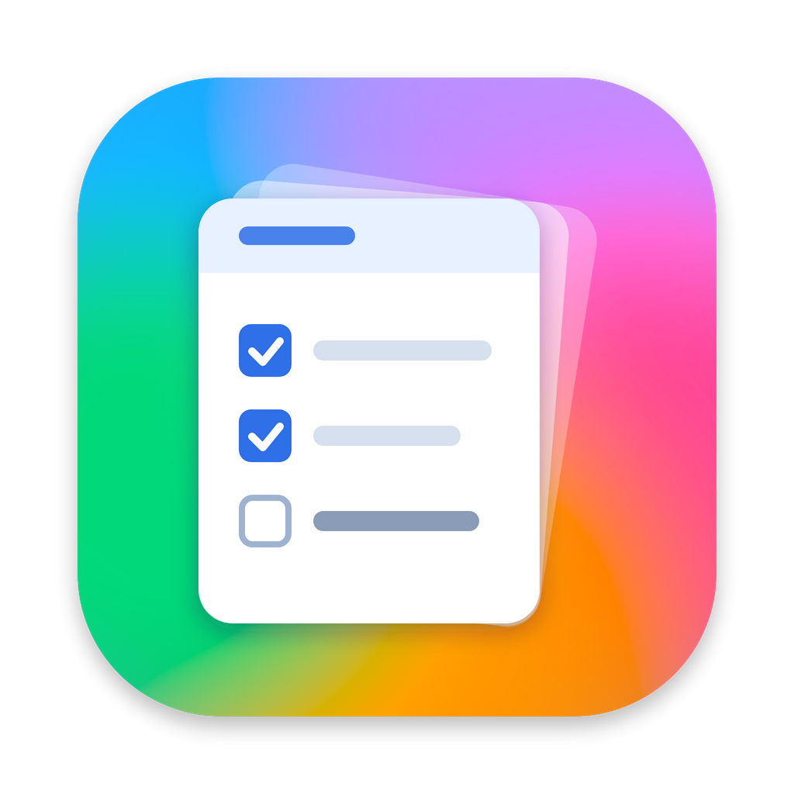
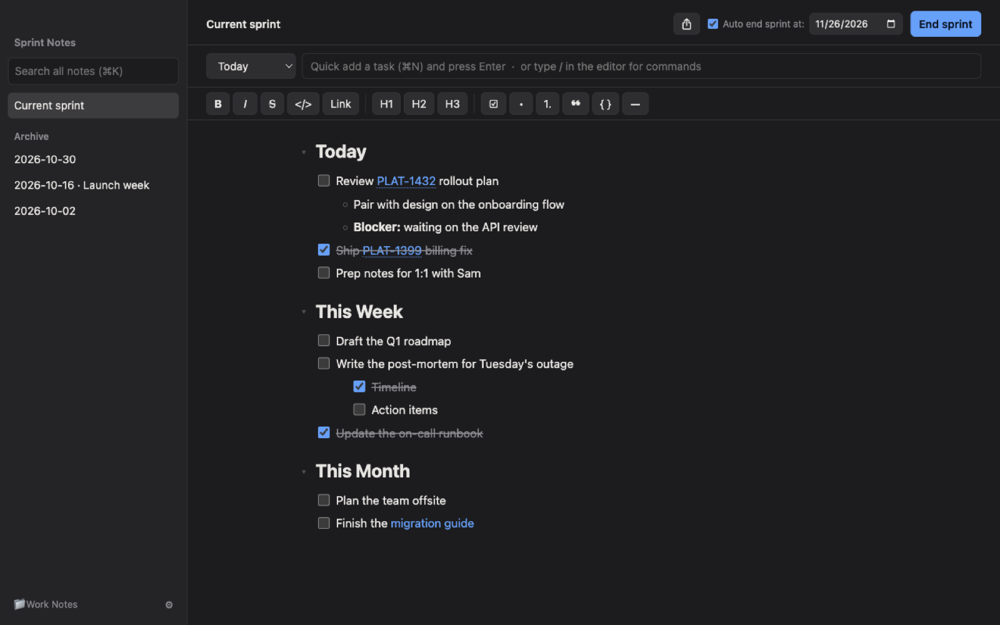
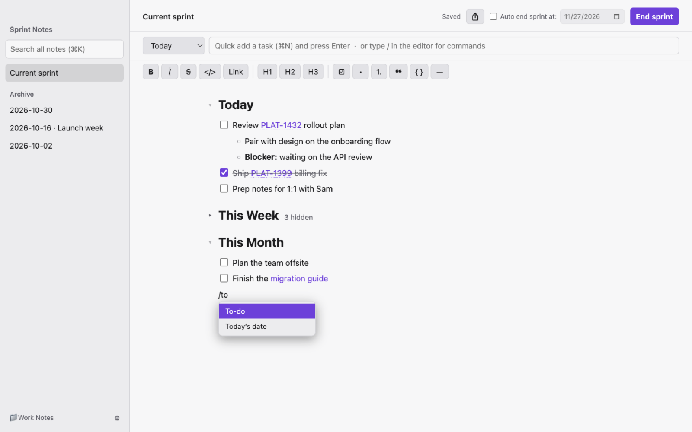
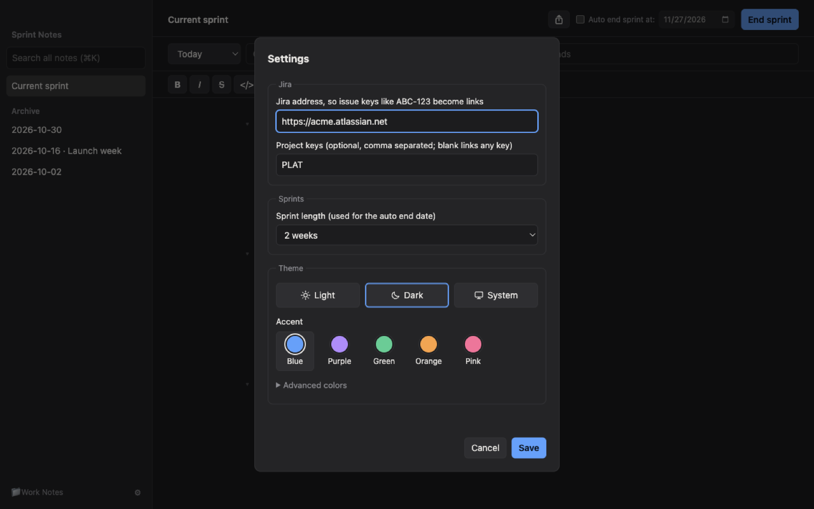

  

<h1 align="center">Sprint Notes</h1>

A macOS app for day-to-day task notes: Today / This Week / This Month checklists in a rich-text editor, with sprint archives you can search and export. Notes are plain markdown files in a folder you choose.

  
  

## Install

You build the app once from source, then use it like any other Mac app. You need macOS and [Node.js](https://nodejs.org) 18 or later.

    git clone https://github.com/cooleo400/sprint-notes.git
    cd sprint-notes
    npm install
    npm run dist

This creates `release/Sprint Notes-<version>-<arch>.dmg` (for your Mac's chip). Open it, drag **Sprint Notes** into Applications, and launch it from there; you won't need the terminal again. To update later, `git pull`, run `npm run dist` again and replace the app.

The app is ad-hoc signed rather than signed with an Apple Developer ID. That's fine on the Mac that built it. If you copy the `.dmg` to another Mac, macOS will block the first launch: open **System Settings → Privacy & Security** and click **Open Anyway** (or have that person build it themselves).

## Development

    npm start          # build the editor bundle and run the app from source
    npm test           # unit tests, then end-to-end tests
    npm run test:unit  # fast: sprint logic + editor behaviour in jsdom (~1s)
    npm run test:e2e   # 34 scenarios in a real Electron window (on Linux: xvfb-run -a npm run test:e2e)
    npm run icon       # regenerate build/icon.png and build/icon.icns from build/icon.svg (macOS)

`src/` is bundled by esbuild into `dist/app.js`; `npm run dist` packages it with electron-builder into `release/`. Both folders are generated and git-ignored.

Run the tests from a normal terminal. VS Code's integrated terminal sets `ELECTRON_RUN_AS_NODE=1`, which stops Electron from starting; there, use `env -u ELECTRON_RUN_AS_NODE npm test`. To run one end-to-end test with full failure output: `ONLY=27 VERBOSE=1 node test/e2e.js`.

First launch asks for a notes folder. It holds `current.md` plus an `archive/` folder with one file per sprint. Everything is plain markdown.

## Editing

The editor is rich text: you never see markdown syntax, but the file on disk is still plain markdown.

- ⌘N from anywhere jumps to the quick-add box on the current sprint; Esc returns to the editor.
- Shortcuts (⌘ or Ctrl): B bold, I italic, T to-do (only the current line; press again to turn it back into text), ↩ check/uncheck a to-do, ⇧⌘X strikethrough, ⌘E inline code, ⌘L link, ⌥⌘1/2/3 headings, ⌘K search.
- Type `* ` or `- ` to start a bullet, `1. ` for a numbered list, `[] ` for a to-do, `# ` / `## ` / `### ` for headings, `> ` for a quote.
- Tab nests the current line (to-do, bullet, heading or paragraph) under the item above it; ⇧Tab moves it back out. A line with no list item above it has nothing to nest under, so Tab leaves it in place. The Today / This Week / This Month headings never nest. Enter on an empty item outdents it, then leaves the list.
- Type `/` for a command menu: headings, to-do, bullets, numbered list, quote, code block, divider, link, today's date.
- Toolbar buttons do the same; clicking a button again removes the formatting.
- Click a link to open it in your browser.

## Settings

⚙ at the bottom of the sidebar:

- **Jira**: your Jira address, e.g. `https://yourcompany.atlassian.net`, and optionally the project keys to match (blank matches any key, which also catches things like UTF-8). Issue keys such as `ABC-123` then show as links in the current sprint and archives; click one to open it. The files keep the plain key, so changing the address later updates every link. Pasting a Jira issue URL (`…/browse/ABC-123`) inserts a link that reads just `ABC-123`, on any Jira site; so does a Jira URL typed or pasted into quick add.
- **Sprint length**: 1–8 weeks (default 2). Used for the auto end date.
- **Theme**: Light, Dark or System (follows macOS), plus an accent preset (Blue, Purple, Green, Orange, Pink; each has a light- and dark-mode shade). *Advanced colors* has a picker for every color; a changed color is kept as an override across mode and preset changes until *Reset colors*. Changes preview live and Cancel restores them.

Settings live in the app's `config.json` (in Electron's user data folder), not in the notes folder.

## Auto end sprint

Tick *Auto end sprint at* beside End sprint and pick a date (it starts one sprint length from today). The first time the app is open on or after that date, the sprint ends by itself: completed tasks are archived and unfinished ones carry over, with no dialog. The date then moves forward by one sprint length. It's off by default.

## Archived sprints

Right-click an archived sprint in the sidebar:

- **Make current sprint** moves its tasks back to the top of Today and This Week in the current sprint (removing the _(not done)_ markers) and moves the archive file to the Trash. Your current tasks stay, so this also undoes an End sprint.
- **Rename…** changes the label after the date, e.g. `2026-10-23_Launch week.md`. The date stays, because sorting and export ranges use it.
- **Move to Trash** moves the file to the macOS Trash, so you can still recover it.

## Folding

Click the arrow beside a `##` heading (Today, This Week, This Month) to fold that section; the heading shows how many items are hidden. Folding only changes the view: the file is untouched, End sprint and quick add still work on folded sections, and opening a search result unfolds the view so the match is visible. Each file remembers its own folded sections.

## Export

The share icon (top right) writes one markdown file with the current sprint, the last 6 months, the last year, everything, or a single archived sprint. Sprints appear oldest first, each under its own `#` heading, with the current sprint last. Any unsaved edits are saved first.

Keep the `## Today`, `## This Week` and `## This Month` headings (any capitalization): End sprint looks for them.
